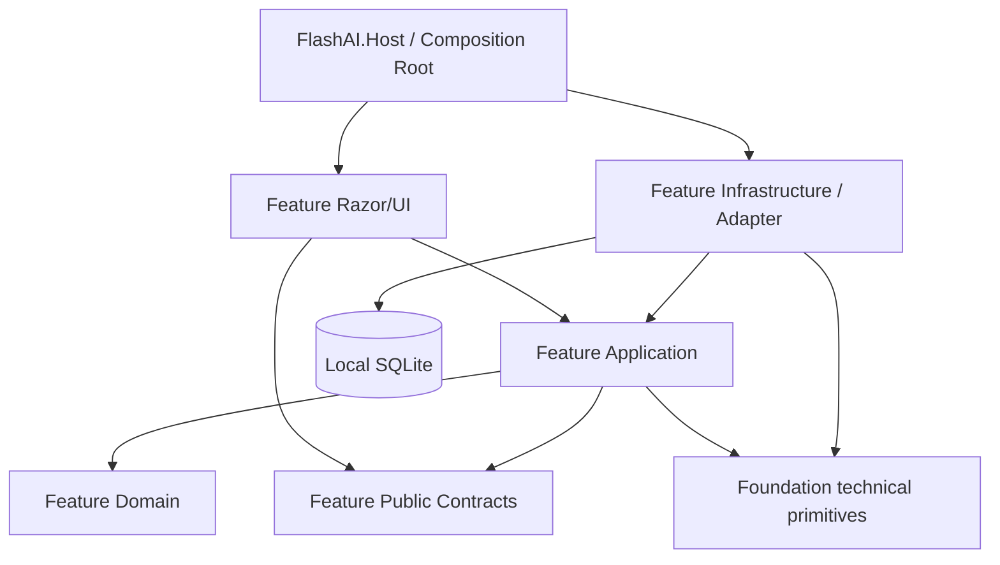
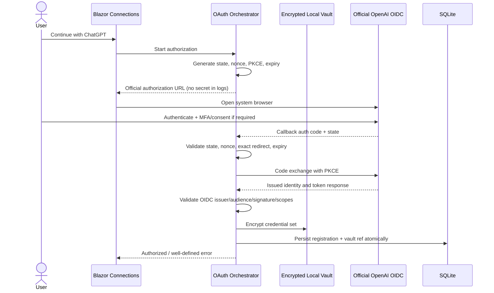

# FLASH AI ACCOUNT MANAGER — MASTER ARCHITECTURE & DEVELOPMENT CONTRACT

> **Tài liệu điều phối kiến trúc (Single Source of Truth)**  
> Dự án: FLASH AI Account Manager — Personal / Local-First Edition  
> Phiên bản tài liệu: 1.0.0 / Draft for implementation  
> Ngày lập: 2026-10-15 (Asia/Ho_Chi_Minh)  
> Trạng thái: **DESIGN ONLY — CHƯA CÓ MÃ NGUỒN, CHƯA KIỂM THỬ, CHƯA XÁC NHẬN PRODUCTION**  
> Đối tượng: 01 người sử dụng trên máy Windows; quản lý hồ sơ và kết nối ChatGPT được ủy quyền.  
> Công nghệ bắt buộc: **C# / .NET 10 LTS / ASP.NET Core / Blazor Web App (Interactive Server) / EF Core / SQLite**.

---

## 0. CÁCH ĐỌC VÀ QUY TẮC ƯU TIÊN

Tài liệu này là hợp đồng triển khai cho người phát triển, Codex, Antigravity hoặc AI agent. Khi có mâu thuẫn, ưu tiên:

1. An toàn dữ liệu, pháp luật, chính sách nhà cung cấp dịch vụ, quy trình xác thực chính thức.
2. Các ranh giới module, luật bảo mật và điều kiện nghiệm thu trong MASTER.
3. Hợp đồng công khai của module; ràng buộc dữ liệu; ADR đã phê duyệt.
4. Cấu trúc source code hiện hữu đã được kiểm tra, miễn không vi phạm (1)-(3).
5. Yêu cầu thẩm mỹ hoặc tối ưu hóa không làm suy giảm các điều trên.

**Không được tuyên bố chức năng đã hoạt động nếu chỉ mới thiết kế.** Phải phân biệt `DESIGNED`, `IMPLEMENTED`, `TESTED`, `RUNTIME VERIFIED`, `RELEASE READY`. Sau mỗi phase, cập nhật kết quả với bằng chứng lệnh chạy, test, bản build và các hạng mục chưa kiểm chứng.

**Nguyên tắc trung tâm từ chủ dự án:** mọi chức năng phải có file, style, thành phần giao diện, logic, validation, truy cập dữ liệu và test riêng; **không tạo một file `global.css` chứa style chức năng; không dồn CRUD, kết nối, settings, 2FA, dashboard vào một service hoặc page dùng chung**. Có một ngoại lệ có chủ đích: các dịch vụ hạ tầng kỹ thuật không mang quy tắc nghiệp vụ (hosting, EF context composition, migration runner, cryptography primitives, DI bootstrap, telemetry redaction, design tokens) có thể tồn tại tập trung để tránh lỗi và phân mảnh bảo mật. Các exception phải nằm trong whitelist tại §4.5.

**Không nhầm “độc lập” với “copy-paste mọi thứ”:** module sở hữu dữ liệu và luồng nghiệp vụ của mình; chỉ giao tiếp qua interface/event/read-model có phiên bản. Không đọc trực tiếp database table của module khác; không import component nội bộ module khác; không viết SQL xuyên module trong UI. Bảo mật và cấu hình chạy phải thống nhất, không tự chế một vault khác nhau cho mỗi màn hình.

---

## 1. TẦM NHÌN, PHẠM VI VÀ GIỚI HẠN

### 1.1 Tuyên bố sản phẩm

FLASH AI Account Manager là công cụ cục bộ để:

- Lưu và sắp xếp **hồ sơ mô tả** các tài khoản ChatGPT do người dùng sở hữu/quản lý hợp lệ.
- Mở trang đăng nhập chính thức và quản lý **OAuth/OIDC connections đã được chính người dùng cho phép**, khi luồng Sign in with ChatGPT tương ứng được nhà cung cấp hỗ trợ và môi trường đáp ứng điều kiện.
- Lưu metadata về danh tính đã xác minh, trạng thái kết nối, scope, thời gian xác minh; không suy luận tùy tiện gói thuê bao hoặc quota.
- Theo dõi ghi chú, nhãn, ngày cần nhắc, gói do người dùng tự xác nhận, lịch sử hoạt động và cảnh báo kết nối.
- Cung cấp local authenticator/TOTP **cho các secret mà người dùng có quyền sử dụng**, tách khỏi luồng ChatGPT OAuth; sinh mã trên máy, không gửi seed ra 2fa.live.
- Cung cấp backup, restore có kiểm soát, khóa vault, audit, thống kê nội bộ, import/export an toàn.

### 1.2 Trong phạm vi (IN)

| ID | Năng lực | Chế độ |
|---|---|---|
| IN-01 | Account CRUD, tag, filter, search, archive, soft delete | Tự động cục bộ |
| IN-02 | Import CSV/XLSX tùy thư viện .NET phù hợp; preview/validation/commit | Người dùng xác nhận |
| IN-03 | Export metadata không nhạy cảm; backup được mã hóa | Người dùng xác nhận |
| IN-04 | Dashboard dựa trên SQLite và nguồn có độ tin cậy ghi rõ | Tự động |
| IN-05 | SIWC/OAuth/OIDC với login/consent chính thức, PKCE và callback | Tương tác người dùng ở bước provider yêu cầu |
| IN-06 | Lưu encrypted token của kết nối được cấp quyền, refresh/revoke theo contract | Có kiểm soát, theo phạm vi được cấp |
| IN-07 | TOTP RFC 6238, local generation; secret được vault bảo vệ | Tự động tại máy cục bộ |
| IN-08 | Background reminders, stale-status checks, job log | Tự động cục bộ |
| IN-09 | SQLite local + encrypted backup + recovery rehearsal | Tự động có kiểm soát |
| IN-10 | Màn hình cài đặt, account security, hoạt động và diagnostics đã redacted | Cục bộ |

### 1.3 Ngoài phạm vi/không triển khai (OUT)

- Tool tự tạo tài khoản ChatGPT hàng loạt, email tạm/giả mạo định danh, captcha solver/stealth/anti-bot evasion.
- Bulk login checker thử email/mật khẩu/OTP liên tục để phân loại `LIVE/DEAD` hoặc né giới hạn đăng nhập.
- Đăng nhập ChatGPT qua endpoint auth không công khai, reverse-engineer login challenge, đánh cắp cookie, scrape session, tự động bypass MFA.
- Đưa password/TOTP seed tới `2fa.live` hoặc dịch vụ ngoài chỉ để lấy mã OTP.
- Sửa/chèn file xác thực `Codex`, ChatGPT Desktop hoặc trình duyệt để chiếm phiên; chia sẻ token sang ứng dụng khác ngoài luồng được nhà cung cấp cho phép.
- Luân chuyển nhiều tài khoản/token nhằm né quota/rate limit hoặc resale quyền truy cập gói cá nhân.
- Tự công bố trạng thái Plus/Pro, hạn mức, thời điểm reset, billing hoặc ban từ API không chính thức.
- Đọc lịch sử hội thoại ChatGPT qua Sign in with ChatGPT; SIWC không cấp phạm vi đó.
- Phục vụ public Internet, nhiều người dùng hoặc multi-tenant trong MVP.
- Yêu cầu Node, React, Next.js, Python, Java, Rust, Tauri, Docker cho ứng dụng chính.

### 1.4 Mức độ tự động hóa thực tế

| Chức năng | Tối đa được cam kết | Không được cam kết |
|---|---|---|
| Quản lý hồ sơ | 100% quy trình CRUD ở local | Tài khoản còn đăng nhập ChatGPT |
| Nhắc nhở / backup | 100% sau khi cấu hình | Khôi phục secrets trên máy khác chỉ từ `.db` |
| OAuth/OIDC | Tự động chuẩn bị và xử lý kết quả, refresh đúng chuẩn | Bỏ qua màn hình đăng nhập/consent/MFA của OpenAI |
| TOTP | Tự sinh mã offline từ seed do người dùng cung cấp | Tự được OpenAI chấp nhận hoặc chứng minh account valid |
| Plan/quota | Hiện dữ liệu đã xác minh có nguồn/timestamp | Tự lấy quota ChatGPT website mà không có API được phép |

**Definition of “Account Healthy”:** chỉ có thể nói *kết nối đã được xác minh hợp lệ tại thời điểm X*; tuyệt đối không lấy khả năng đăng nhập/sở hữu/gói/khả năng sử dụng ChatGPT làm một biến Boolean duy nhất.

### 1.5 Nhóm thực thể khác biệt cần tách

- `AccountRecord`: hồ sơ do người dùng nhập, chưa chắc có kết nối.
- `ProviderIdentity`: danh tính được nhà cung cấp xác minh (issuer, subject, email), có thể khác email hiển thị.
- `OAuthRegistration`: client ID được cấp cho đúng account/host/workspace.
- `AuthorizedSession`: bộ token của đúng một registration, có version, scopes, expiry.
- `SubscriptionObservation`: thông tin gói/giới hạn có `source`, `observedAt`, `confidence`, có thể chưa được xác minh.
- `TotpCredential`: credential authenticator riêng; **không phải ChatGPT session**.
- `BackgroundJob`: trạng thái tác vụ nội bộ; **không được tạo ra một bản ghi “đăng nhập thành công” từ job reminder**.

---

## 2. NGUỒN THAM KHẢO VÀ QUYẾT ĐỊNH KHÔNG SAO CHÉP

Ngày nghiên cứu: 2026-10-15. Các nguồn GitHub là third-party, không mặc định đáng tin cậy; kiểm tra license và bảo mật trước khi sử dụng mã. Các chỉ số repository và cơ chế bên trong có thể thay đổi.

| Nguồn | Bản chất quan sát được | Học hỏi | Không sao chép |
|---|---|---|---|
| [ChatGPT-GenAcc](https://github.com/Ap0dexMe0/ChatGPT-GenAcc) | Python/Playwright; auto account creation, temporary email, stealth; output plaintext | Chia nhỏ cấu hình/logging dưới góc độ cấu trúc | Auto signup, stealth, plaintext password, bulk account creation |
| [SwitchAI Account Manager](https://github.com/vezlin1/SwitchAI-Account-Manager) | Rust/Tauri; quản lý account, local encrypted vault, quota display, switching | Account list UX, account state, vault, search, privacy, backup | Chọc sửa file auth của app khác, lấy token không qua authorization |
| [9Router](https://github.com/decolua/9router) | Next.js/Node; gateway/provider abstraction/routing | Adapter architecture, dashboard, status/error taxonomy | Rotation qua subscriptions, proxy/endpoint bí mật, hạn mức “unlimited” |
| [OpenAI SIWC overview](https://developers.openai.com/siwc/token-sharing-open-source) | Official OSS OAuth, host identity, optional plan-use scopes | Tích hợp được ủy quyền theo tài liệu | Cho rằng có quyền đọc chat/billing hay quản lý mọi phiên |
| [OpenAI SIWC sign-in](https://developers.openai.com/siwc/token-sharing-open-source/sign-in) | Host ID, dynamic registration, issued client ID, callback, token handling | Đăng ký và xác thực danh tính đúng chuẩn | Dùng `dynamic_agent_client` làm issued client ID về sau |
| [OpenAI SIWC sessions](https://developers.openai.com/siwc/token-sharing-open-source/profiles-and-sessions) | Multi-registrations; refresh/revoke; token security | Mỗi phiên riêng, refresh serialized, revoke | Trộn token, client ID, host giữa các tài khoản |
| [OpenAI SIWC token reference](https://developers.openai.com/siwc/token-sharing-open-source/token-reference) | Token lifetime/fields hiện tại | Token adapter có version, kiểm thử expiry | Hard-code assumption vĩnh viễn |
| [OpenAI account sharing policy](https://help.openai.com/en/articles/10471989) | Personal account, not for sharing | Personal-only governance | Sharing/reselling credentials |
| [Microsoft Blazor EF Core](https://learn.microsoft.com/en-us/aspnet/core/blazor/blazor-ef-core?view=aspnetcore-10.0) | Blazor server circuit khác HTTP request, DbContext lifetime | IDbContextFactory, mỗi operation một context | Scoped DbContext giữ trong circuit dài hạn |
| [ASP.NET Core Data Protection](https://learn.microsoft.com/en-us/aspnet/core/security/data-protection) | At-rest keys/cookie protection | Bảo vệ server-side credentials | Lưu key plaintext cạnh ciphertext |
| [SQLite WAL](https://www.sqlite.org/wal.html) | WAL + database locking | Ngắn transaction, backup consistent | Copy db tùy tiện khi process đang chạy |

**Ghi chú pháp lý/kỹ thuật:** MIT của dự án tham khảo không tự động biến code thuộc bên thứ ba thành “source của chúng ta”. Không copy nguyên code nếu chưa kiểm tra license/transitive dependency. Chỉ học patterns; dự án mới viết C#.

---

## 3. STACK VÀ DEPLOYMENT PROFILE

### 3.1 Stack đóng băng cho MVP

| Tầng | Công nghệ | Chú ý |
|---|---|---|
| UI/SSR/Interactive | Blazor Web App, Interactive Server, Razor Components | Không WebAssembly chứa secret |
| Hosting | ASP.NET Core Kestrel, Windows localhost | Không lộ `0.0.0.0`, domain public, VPS |
| Domain/Use cases | C# 14 / .NET 10 | DI interfaces; async/cancellation |
| Persistence | EF Core 10, Microsoft.EntityFrameworkCore.Sqlite | Migrations review, DbContextFactory |
| Database | SQLite, 1 DB file local | WAL/foreign_keys/busy_timeout |
| Job host | .NET `BackgroundService`, `PeriodicTimer` | Scheduler logic riêng module |
| Security | ASP.NET Core Data Protection, Windows DPAPI user scope, cryptographic RNG | Bảo quản/recovery key ring |
| Auth | OIDC/OAuth via official SIWC if eligible; PKCE, state, nonce, token verification | Không tự nhận quyền trước khi được cấp |
| Browser | Mặc định dùng trình duyệt người dùng qua system launcher | Không điều khiển login forms |
| Local notifications | In-app; optionally Windows toast qua .NET library đã duyệt | Không phụ thuộc dịch vụ cloud |
| Import | CSV built-in; XLSX qua NuGet .NET nếu cần | Chống spreadsheet formula injection |
| Logging | `ILogger` với redaction / rolling local sinks được duyệt | Không log token, seed, password, callback code |
| Testing | xUnit hoặc MSTest (chốt xUnit), bUnit nếu phù hợp, TestServer, SQLite temporary DB | Integration mô phỏng provider |
| Build | `dotnet restore/build/test/publish` | Không cần npm |

.NET 10 là LTS đến tháng 11/2028 tại thời điểm lập tài liệu. Pin package version và kiểm tra CVE khi bắt đầu code, không tự đoán patch hiện tại.

### 3.2 Developer experience

- Clone repo, cài .NET 10 SDK, `dotnet restore`, `dotnet run --project src/FlashAI.Host`.
- Launcher mở URL từ port chạy thực tế, không mặc định cổng cố định nếu bị chiếm.
- Một process ứng dụng ASP.NET Core; không Vite hoặc API backend riêng.
- Không require PostgreSQL, SQL Server, Redis, RabbitMQ, Docker.
- Dev/test/prod mỗi môi trường có DB path và key ring độc lập. Development không đọc production vault.
- Production trên Windows có thể `dotnet publish -c Release -r win-x64 --self-contained true` (chốt framework publish sau validation).

### 3.3 Đường dẫn dữ liệu đề xuất trên Windows

```text
%LOCALAPPDATA%/FlashAIAccountManager/
├── data/
│   ├── flashai.db
│   ├── flashai.db-wal       (runtime only)
│   └── flashai.db-shm       (runtime only)
├── security/
│   ├── key-ring/           (DPAPI-protected-at-rest)
│   └── vault/              (encrypted secret blobs)
├── backups/                (encrypted exports / consistent snapshots)
├── logs/                   (redacted only)
├── temp/                   (ephemeral, cleaned)
└── settings/               (non-secret preferences)
```

**Không đặt SQLite/secret/keyring dưới `wwwroot/`, git, roaming cloud-sync folder hoặc công khai qua static-files middleware.** Chỉ cấp ACL cho Windows user đang chạy app; tạo thư mục atomic, từ chối symlinks hoặc đường dẫn traversal khi nhập file.

---

## 4. KIẾN TRÚC MODULE ĐỘC LẬP — QUY ĐỊNH BẮT BUỘC

### 4.1 Mô hình Vertical Slice Module

Mỗi chức năng là một bounded feature slice sở hữu:

1. `*.razor`: entry page riêng.
2. `*.razor.css`: CSS isolation riêng, không dựa vào selector của page khác.
3. `Components/`: các component chỉ thuộc module.
4. `Contracts/`: request/response/interface public của chính module.
5. `Application/`: command, query, policy, validators riêng.
6. `Domain/`: entity/value object/enum riêng.
7. `Persistence/`: repository, mapping EF Core riêng; chỉ dùng infrastructure boundary cho DbContext.
8. `Integration/`: provider adapter/HTTP client chuyên biệt riêng nếu cần.
9. `Tests/`: unit, integration, UI regression theo module.
10. `README.md`: scope, route, config, data ownership, acceptance, dependencies.

**Không có `AccountService.cs` 2.000 dòng; không có `AllPages.razor`; không có `shared.js`; không có file CSS chung chứa `.accounts-*`, `.settings-*`, `.totp-*`.**

### 4.2 Định nghĩa độc lập

- Build-time: module không reference implementation của module khác.
- Runtime: module chỉ gọi published port/interface của module khác khi cần, qua DI mediator/port adapter; cross-feature call phải có test.
- UI: không import private components của module khác; feature cung cấp UI entry qua route, không share modal chứa nghiệp vụ.
- Data: module chỉ ghi bảng do module đó sở hữu. Cross-module foreign key `AccountId` là reference identity, không tạo ownership chéo; muốn hiển thị tên account dùng public read-model port.
- Styling: tên class/variable module scoped, tránh `body`, `button`, `input`, `a` trong `.razor.css` ngoại trừ reset foundation được cho phép.
- State: không sử dụng singleton mutable state chứa thông tin account hoặc token. Scoped UI state chỉ tồn tại tại module/connection cụ thể.
- Testing: module tests chạy độc lập với mock adapter/temporary DB.
- File ownership: một file code do một module sở hữu; PR/agent không chỉnh file ngoài module nếu không nêu lý do.

### 4.3 Khi nào module được gọi module khác

Ví dụ Subscription cần biết account tồn tại:

- Được phép: `IAccountIdentityReader.ExistsAsync(accountId)` do Accounts `Contracts` cung cấp; CompositionRoot bind implementation.
- Không: `Subscriptions` query `db.Accounts` trực tiếp hoặc `using FlashAI.Modules.Accounts.Persistence`.
- Dashboard có quyền gọi các `IDashboardContribution` public projections; không query bảng private.
- Import gửi `CreateAccountCommand` qua Accounts public port; không insert `Accounts` trực tiếp.
- Nếu việc liên kết tăng coupling đáng kể, chọn event internal như `AccountArchivedV1` hoặc query projection read-only có version.

### 4.4 Quy tắc CSS và giao diện độc lập

- `AccountList.razor` ↔ `AccountList.razor.css`; `AccountDetail.razor` ↔ `AccountDetail.razor.css`.
- `AuthenticatorPage.razor.css` chỉ làm việc trong Authenticator; không sửa layout Dashboard.
- Bên trong module, mỗi modal lớn (`EditAccountDialog.razor`) có `EditAccountDialog.razor.css` tương ứng.
- Chỉ `Foundation` chứa `tokens.css`, `fonts.css`, `reset.css`, `shell.css` (khung app chứ không nghiệp vụ). Theme dùng CSS custom properties (`--flash-*`), không dùng UI library bắt buộc.
- Không inject inline `<style>` trong các page, không dùng `!important` đại trà, không `@import` một stylesheet chức năng từ chức năng khác.
- Style không chia sẻ không đồng nghĩa với thiếu nhất quán: CSS design tokens định nghĩa một chỗ, module tự dùng.
- Yêu cầu responsive độc lập: 375, 768, 1024, 1280, 1440 px; mobile menu, tables responsive, modal không vượt viewport, 200% zoom, keyboard navigation.

### 4.5 Whitelist hạ tầng kỹ thuật được dùng chung

| Shared Technical Component | Cho phép | Không được làm |
|---|---|---|
| `FlashAI.Foundation.Hosting` | Kestrel, DI wiring, middleware, config | Nghiệp vụ account/check |
| `FlashAI.Foundation.Persistence` | DbContextFactory, connection settings, migrations aggregator, transaction policy | CRUD module nghiệp vụ |
| `FlashAI.Foundation.Security` | Data Protection, DPAPI key protection, vault interfaces/primitives, CSRF/security headers | Phát quyết trạng thái account |
| `FlashAI.Foundation.Observability` | Structured logs redaction, error codes, tracing | Log secrets hoặc nuốt lỗi |
| `FlashAI.Foundation.Contracts` | IDs, `Result<T>`, Clock, event envelope, cancellation | DTO siêu rộng chung cho mọi module |
| `FlashAI.Foundation.UI` | App shell, icons, typography, color tokens, accessible primitives | Form business, modal business, per-feature CSS |
| `FlashAI.Foundation.Composition` | Đăng ký modules, migrations scan, startup checks | Business branching theo loại account |

Mọi thay đổi vào Foundation cần test hồi quy toàn bộ; Foundation phải nhỏ, ổn định, không thành “god-project”.

### 4.6 Quy tắc đặt tên file

- Namespace: `FlashAI.Modules.<Feature>.<Layer>`.
- `FeatureNamePage.razor`, `FeatureNamePage.razor.css`.
- `CreateAccountCommand.cs`, `CreateAccountHandler.cs`, `CreateAccountValidator.cs`.
- `AccountRepository.cs`, `AccountEntityConfiguration.cs`.
- `FeatureModuleRegistration.cs` chịu trách nhiệm DI riêng.
- `FeatureEndpoints.cs` chỉ khi feature có HTTP endpoints nội bộ thực sự; Blazor UI không buộc xây REST API.
- `Feature.Tests/<Feature>...Tests.cs` rõ tên tình huống.
- Không tạo class tên chung chung `Manager`, `Helper`, `Utils`, `CommonService`, `GlobalData`.

### 4.7 Hướng phụ thuộc



Không có `Domain -> UI`, không có `Domain -> EF Core`, không có `Foundation -> Feature`. Host mới là nơi compose các module. Với cross-feature, consumers chỉ tham chiếu `Contracts` public (không tham chiếu `Application`, `Persistence`, `UI` của đối tác).

---

## 5. CÂY THƯ MỤ CHUẨN (DỰ KIẾN)

Đây là **target architecture**, chưa phải bản kê các file đã tồn tại. Với module trong cây, các file liệt kê là chủ sở hữu của chức năng; không tự động tạo file thừa nếu chưa có use case.

```text
FLASH-AI-ACCOUNT-MANAGER/
├── README.md
├── MASTER.md                           # chính tài liệu này
├── FlashAI.sln
├── Directory.Build.props
├── Directory.Packages.props
├── global.json                         # SDK version được pin sau khi xác minh
├── .editorconfig
├── .gitignore
├── docs/
│   ├── architecture/
│   │   ├── ADR-0001-modular-monolith.md
│   │   ├── ADR-0002-local-only.md
│   │   ├── ADR-0003-sqlite.md
│   │   ├── ADR-0004-secret-vault.md
│   │   ├── ADR-0005-official-auth.md
│   │   └── data-ownership.md
│   ├── security/
│   │   ├── threat-model.md
│   │   ├── credentials-handling.md
│   │   ├── backup-restore.md
│   │   └── oauth-threat-analysis.md
│   ├── design-system/
│   │   ├── tokens.md
│   │   ├── responsive.md
│   │   └── accessibility.md
│   ├── runbooks/
│   │   ├── development.md
│   │   ├── local-release.md
│   │   ├── migration-rollback.md
│   │   └── incident-response.md
│   └── ai/
│       ├── prompts/
│       └── phase-reports/
├── src/
│   ├── FlashAI.Host/
│   │   ├── FlashAI.Host.csproj
│   │   ├── Program.cs                  # composition only
│   │   ├── App.razor
│   │   ├── Routes.razor
│   │   ├── appsettings.json            # non-secrets only
│   │   ├── appsettings.Development.json
│   │   ├── Properties/launchSettings.json
│   │   ├── Components/Layout/
│   │   │   ├── MainLayout.razor
│   │   │   ├── MainLayout.razor.css
│   │   │   ├── Navigation.razor
│   │   │   └── Navigation.razor.css
│   │   └── wwwroot/foundation/
│   │       ├── tokens.css
│   │       ├── reset.css
│   │       ├── typography.css
│   │       ├── shell.css
│   │       └── assets/                  # logo/icons/fonts licensed
│   ├── FlashAI.Foundation/
│   │   ├── Hosting/
│   │   │   ├── LocalBindingGuard.cs
│   │   │   ├── StartupValidator.cs
│   │   │   └── SecurityHeaders.cs
│   │   ├── Persistence/
│   │   │   ├── FlashAiDbContext.cs     # technical EF composition only
│   │   │   ├── SqliteConnectionFactory.cs
│   │   │   ├── MigrationCoordinator.cs
│   │   │   ├── ModelConfigurationScanner.cs
│   │   │   └── Migrations/            # generated, reviewed, source controlled
│   │   ├── Security/
│   │   │   ├── ISecretVault.cs
│   │   │   ├── WindowsSecretVault.cs
│   │   │   ├── DataProtectionSetup.cs
│   │   │   ├── SecureMemoryHandling.cs
│   │   │   └── LocalAccessPolicy.cs
│   │   ├── Observability/
│   │   │   ├── SensitiveDataRedactor.cs
│   │   │   ├── SafeAuditWriter.cs
│   │   │   └── ErrorCatalog.cs
│   │   ├── Contracts/
│   │   │   ├── IClock.cs
│   │   │   ├── IModule.cs
│   │   │   ├── Result.cs
│   │   │   └── EventEnvelope.cs
│   │   └── Composition/
│   │       └── ModuleLoader.cs
│   └── Modules/
│       ├── Dashboard/
│       │   ├── DashboardModuleRegistration.cs
│       │   ├── UI/DashboardPage.razor
│       │   ├── UI/DashboardPage.razor.css
│       │   ├── UI/Components/StatsGrid.razor
│       │   ├── UI/Components/StatsGrid.razor.css
│       │   ├── Contracts/IDashboardContribution.cs
│       │   ├── Application/GetDashboardQuery.cs
│       │   ├── Application/GetDashboardHandler.cs
│       │   └── README.md
│       ├── Accounts/
│       │   ├── AccountsModuleRegistration.cs
│       │   ├── UI/AccountListPage.razor
│       │   ├── UI/AccountListPage.razor.css
│       │   ├── UI/AccountDetailPage.razor
│       │   ├── UI/AccountDetailPage.razor.css
│       │   ├── UI/Components/EditAccountDialog.razor
│       │   ├── UI/Components/EditAccountDialog.razor.css
│       │   ├── Domain/AccountRecord.cs
│       │   ├── Domain/AccountTag.cs
│       │   ├── Domain/AccountStatus.cs
│       │   ├── Contracts/IAccountCatalog.cs
│       │   ├── Contracts/AccountSummary.cs
│       │   ├── Application/CreateAccountCommand.cs
│       │   ├── Application/CreateAccountHandler.cs
│       │   ├── Application/CreateAccountValidator.cs
│       │   ├── Application/UpdateAccountHandler.cs
│       │   ├── Application/ArchiveAccountHandler.cs
│       │   ├── Application/SearchAccountsQuery.cs
│       │   ├── Persistence/AccountRepository.cs
│       │   ├── Persistence/AccountEntityConfiguration.cs
│       │   └── README.md
│       ├── Connections/
│       │   ├── ConnectionsModuleRegistration.cs
│       │   ├── UI/ConnectionsPage.razor
│       │   ├── UI/ConnectionsPage.razor.css
│       │   ├── UI/ConnectionDetailPage.razor
│       │   ├── UI/ConnectionDetailPage.razor.css
│       │   ├── UI/Components/ConnectDialog.razor
│       │   ├── UI/Components/ConnectDialog.razor.css
│       │   ├── Domain/ProviderIdentity.cs
│       │   ├── Domain/OAuthRegistration.cs
│       │   ├── Domain/AuthorizedSession.cs
│       │   ├── Domain/ConnectionStatus.cs
│       │   ├── Contracts/IConnectionSummaryReader.cs
│       │   ├── Contracts/ConnectionSnapshot.cs
│       │   ├── Application/StartAuthorizationHandler.cs
│       │   ├── Application/CompleteAuthorizationHandler.cs
│       │   ├── Application/RefreshSessionHandler.cs
│       │   ├── Application/DisconnectSessionHandler.cs
│       │   ├── Application/SwitchActiveRegistrationHandler.cs
│       │   ├── Application/ConnectionStateMachine.cs
│       │   ├── Integration/OpenAiSiwcAdapter.cs
│       │   ├── Integration/OidcMetadataResolver.cs
│       │   ├── Integration/TokenValidator.cs
│       │   ├── Persistence/ConnectionRepository.cs
│       │   ├── Persistence/ConnectionEntityConfiguration.cs
│       │   └── README.md
│       ├── Subscriptions/
│       │   ├── SubscriptionsModuleRegistration.cs
│       │   ├── UI/SubscriptionsPage.razor
│       │   ├── UI/SubscriptionsPage.razor.css
│       │   ├── UI/Components/SubscriptionEditor.razor
│       │   ├── UI/Components/SubscriptionEditor.razor.css
│       │   ├── Domain/SubscriptionObservation.cs
│       │   ├── Contracts/ISubscriptionSummaryReader.cs
│       │   ├── Application/UpsertObservationHandler.cs
│       │   ├── Application/GetObservationsQuery.cs
│       │   ├── Persistence/SubscriptionRepository.cs
│       │   ├── Persistence/SubscriptionEntityConfiguration.cs
│       │   └── README.md
│       ├── Authenticator/
│       │   ├── AuthenticatorModuleRegistration.cs
│       │   ├── UI/AuthenticatorPage.razor
│       │   ├── UI/AuthenticatorPage.razor.css
│       │   ├── UI/Components/AddTotpDialog.razor
│       │   ├── UI/Components/AddTotpDialog.razor.css
│       │   ├── Domain/TotpCredentialRecord.cs
│       │   ├── Application/AddTotpCredentialHandler.cs
│       │   ├── Application/GenerateTotpCodeHandler.cs
│       │   ├── Application/VerifyTotpInputHandler.cs
│       │   ├── Integration/Rfc6238TotpGenerator.cs
│       │   ├── Persistence/TotpRepository.cs
│       │   ├── Persistence/TotpEntityConfiguration.cs
│       │   └── README.md
│       ├── ImportExport/
│       │   ├── ImportExportModuleRegistration.cs
│       │   ├── UI/ImportExportPage.razor
│       │   ├── UI/ImportExportPage.razor.css
│       │   ├── UI/Components/ImportPreview.razor
│       │   ├── UI/Components/ImportPreview.razor.css
│       │   ├── Application/ParseImportHandler.cs
│       │   ├── Application/PreviewImportHandler.cs
│       │   ├── Application/CommitImportHandler.cs
│       │   ├── Application/ExportMetadataHandler.cs
│       │   ├── Integration/CsvReader.cs
│       │   ├── Contracts/ImportRowResult.cs
│       │   └── README.md
│       ├── Reminders/
│       │   ├── RemindersModuleRegistration.cs
│       │   ├── UI/RemindersPage.razor
│       │   ├── UI/RemindersPage.razor.css
│       │   ├── Domain/Reminder.cs
│       │   ├── Application/CreateReminderHandler.cs
│       │   ├── Application/ResolveDueRemindersHandler.cs
│       │   ├── Background/ReminderWorker.cs
│       │   ├── Persistence/ReminderRepository.cs
│       │   └── README.md
│       ├── BackupRestore/
│       │   ├── BackupRestoreModuleRegistration.cs
│       │   ├── UI/BackupRestorePage.razor
│       │   ├── UI/BackupRestorePage.razor.css
│       │   ├── Application/CreateEncryptedBackupHandler.cs
│       │   ├── Application/ValidateBackupHandler.cs
│       │   ├── Application/RestoreBackupHandler.cs
│       │   ├── Integration/PortableBackupFormat.cs
│       │   └── README.md
│       ├── Activity/
│       │   ├── ActivityModuleRegistration.cs
│       │   ├── UI/ActivityPage.razor
│       │   ├── UI/ActivityPage.razor.css
│       │   ├── Contracts/IAuditSink.cs
│       │   ├── Application/SearchAuditEventsHandler.cs
│       │   ├── Domain/AuditEvent.cs
│       │   ├── Persistence/AuditRepository.cs
│       │   └── README.md
│       ├── Settings/
│       │   ├── SettingsModuleRegistration.cs
│       │   ├── UI/SettingsPage.razor
│       │   ├── UI/SettingsPage.razor.css
│       │   ├── UI/Components/SecuritySettingsPanel.razor
│       │   ├── UI/Components/SecuritySettingsPanel.razor.css
│       │   ├── Domain/LocalPreferences.cs
│       │   ├── Application/UpdatePreferencesHandler.cs
│       │   ├── Persistence/PreferencesRepository.cs
│       │   └── README.md
│       └── Diagnostics/
│           ├── DiagnosticsModuleRegistration.cs
│           ├── UI/DiagnosticsPage.razor
│           ├── UI/DiagnosticsPage.razor.css
│           ├── Application/CollectSafeDiagnosticsHandler.cs
│           └── README.md
├── tests/
│   ├── FlashAI.ArchitectureTests/
│   │   ├── DependencyDirectionTests.cs
│   │   ├── CssIsolationTests.cs
│   │   └── SecretLoggingGuardTests.cs
│   ├── FlashAI.IntegrationTests/
│   │   ├── SqliteMigrationTests.cs
│   │   ├── BackupRestoreTests.cs
│   │   ├── LocalBindingTests.cs
│   │   └── OAuthCallbackTests.cs
│   └── Modules/
│       ├── Accounts.Tests/
│       ├── Connections.Tests/
│       ├── Subscriptions.Tests/
│       ├── Authenticator.Tests/
│       ├── ImportExport.Tests/
│       ├── Reminders.Tests/
│       ├── BackupRestore.Tests/
│       ├── Activity.Tests/
│       ├── Settings.Tests/
│       ├── Dashboard.Tests/
│       └── Diagnostics.Tests/
└── tools/
    ├── architecture-check/
    ├── secret-scan/
    └── release-check/
```

### 5.1 Project packaging

Trên cây thư mục, mỗi module là thư mục độc lập về ownership. Khi triển khai có thể tách từng module thành `.csproj` riêng để compiler thực thi ranh giới. **Ưu tiên giai đoạn đầu:** mỗi feature `FlashAI.Modules.<Name>.csproj`, `FlashAI.Foundation.csproj`, `FlashAI.Host.csproj`, và mỗi feature `.Tests.csproj`. Bất kỳ bộ đóng gói nào vẫn phải kiểm tra không có project cycle, reference trái chiều hoặc private namespace leakage.

### 5.2 Migrations không phá modularity

Vì SQLite dùng **một database duy nhất** và EF Core cần một model nhất quán, Foundation có một `FlashAiDbContext` technical aggregator với `IEntityTypeConfiguration<T>` của từng feature được đăng ký bằng assembly scanning/explicit module descriptors. `Foundation.Persistence.Migrations` sở hữu snapshot/migrations ở mức release để ngăn hai module ghi schema cùng lúc. Feature vẫn sở hữu entity/config/repository và không được truy cập table của feature khác. Chỉ migration PR được reviewer phê duyệt mới đổi schema. Không cho mỗi module tự chạy `Database.Migrate()` trên startup với migration history riêng vào cùng DB mà chưa thiết kế điều phối.

---

## 6. DANH MỤC CHỨC NĂNG VÀ HỢP ĐỒNG MODULE

### 6.1 M01 Dashboard

**Route** `/dashboard`. **Ownership** chỉ projections đã công bố, không bảng riêng (có thể cache transient riêng).

- KPI: tổng hồ sơ, hồ sơ đã lưu trữ, connection đã xác minh, connection yêu cầu reauth, reminder due, backup gần nhất.
- Nguồn dữ liệu: Accounts, Connections, Reminders, BackupRestore thông qua `IDashboardContribution` hoặc các public query port.
- Biểu đồ: thay đổi trạng thái theo thời gian từ snapshot hợp lệ; không giả định test login/plan.
- Empty state: chưa có hồ sơ → mời tạo tài khoản, không hiển thị số giả.
- `Last verified` khác `Last checked`; nếu thiếu nguồn, ghi `Không có dữ liệu xác minh`.
- Thống kê không được làm lộ full email trên màn hình khóa.
- Tests: counters đúng, zero state, stale snapshot, loading/failure, không cross-table direct query.

### 6.2 M02 Accounts

**Routes** `/accounts`, `/accounts/{id}`. **Bảng sở hữu:** `Accounts`, `AccountTags`, `AccountTagLinks`.

Fields: `Id(Guid)`, `Provider(OpenAI)`, `DisplayLabel`, `EmailNormalized`, `EmailDisplay`, `Note`, `Status(LocalActive|Archived|Deleted)`, `CreatedUtc`, `UpdatedUtc`, `Version`.

Use cases: create/edit/archive/unarchive; duplicate hint; tag assign; paged search/sort; preview masking; copy email with explicit click; metadata import through public command port; soft delete then purge separately.

**Quan trọng:** email **không phải unique identity của OAuth registration**. Có thể tồn tại nhiều registration cùng email do workspace/host/client khác nhau; nội bộ Accounts có thể khuyên tránh trùng hồ sơ nhưng không enforce unique cross-registration. AccountRecord là hồ sơ tổ chức, không tự chứng minh login.

Validations: email hợp lệ với giới hạn length, Unicode label normalized, notes bounded; không chấp nhận raw HTML để render; optional fields; conflict detection `Version`; soft delete policy. Không ghi bất kỳ `password` vào AccountRecord.

Tests: CRUD, duplicate detection không gộp nhầm registrations, filter có paging, archive read behavior, HTML XSS escaped, conflict save.

### 6.3 M03 Connections / SIWC

**Routes** `/connections`, `/connections/{registrationId}`. **Bảng:** `ProviderIdentities`, `OAuthRegistrations`, `AuthorizedSessions`, `AuthorizationTransactions` (chỉ dữ liệu giao dịch chưa nhạy cảm và có TTL; code/verifier lưu vault/ephemeral).

Use cases:

1. Bắt đầu `Continue with ChatGPT`: generate unique transaction ID/state/nonce/PKCE verifier using secure RNG; lấy OIDC discovery metadata từ domain chính thức; đặt redirect URI đúng đăng ký; mở browser system.
2. First-time OSS dynamic registration theo tài liệu **nếu luồng phù hợp với phiên bản app**: host ID ổn định, entrypoint `dynamic_agent_client`, nhận issued `client_id` trong callback rồi lưu đúng registration.
3. Callback: state one-time, issuer/audience/signature/JWKS/nonce/expiry verification, exact redirect checks, PKCE token exchange, map immutable provider subject, save credential set atomically.
4. Refresh: per-registration async lock / optimistic version, không concurrent refresh cùng token; replacement refresh token được thay đồng bộ với access token và expiration; đánh dấu `NeedsReauthorization` khi invalid grant.
5. Switch selected registration: chỉ đổi `ActiveRegistrationId` cho các nghiệp vụ *trong chính ứng dụng* đã được cấp scope; không modify Codex/Desktop/Chrome auth files.
6. Disconnect: stop jobs, revoke renewable session khi có thể, clear tokens; nếu provider không xác nhận revoke, hiển thị `LocalDisconnectedRemoteUnknown` và hướng dẫn revoke trong ChatGPT Settings.
7. Reconnect: reuse issued client ID khi hợp đồng cho phép; không tái cấp client mới vô hạn.

**Không lấy OAuth scope `openid profile email` làm quyền dùng Responses API.** Nếu không có `chatgpt.tokens.use.direct` và các scope cần thiết, chỉ có identity, không có quyền inference. Không mặc định bật inference trong MVP; nếu mở rộng, phải có consent riêng, review bản SIWC chính thức hiện hành và giới hạn của preview.

**Connection status state machine**:

```text
NotConnected
  -> AuthorizationPending
  -> Authorized (chỉ sau ID token valid + persistence success)
  -> Refreshing
  -> Authorized | NeedsReauthorization | TemporarilyUnavailable
  -> Disconnecting
  -> Disconnected | LocalDisconnectedRemoteUnknown

AuthorizationPending -> Cancelled | Expired | Error
```

- `ProviderIdentity` uniqueness: `(Issuer, Subject)` là định danh provider; registration uniqueness bổ sung `(Provider, Issuer, Subject, ClientId, HostId, WorkspaceKey)` theo dữ liệu thực tế; không lấy email làm khóa.
- `AuthorizationTransactions` expire rất ngắn, one-time, callback replay rejected.
- `AuthorizedSessions` reference secret vault, không chứa refresh token plaintext.
- Alert `ExpiresAt` phải dựa trên provider token contract hiện hành, không dùng giá trị đoán.
- No login via 2fa.live; no password autofill and no headless browser login.
- Tests: happy path with mock issuer/JWKS; state mismatch, nonce mismatch, wrong aud/iss, replay, clock skew, expired callback, swapped identities, refresh races, rotating token replaced, revoke failure, network timeout, consent denial, local persistence failure, app restart recovery.

### 6.4 M04 Subscriptions and Observations

**Route** `/subscriptions`. **Bảng:** `SubscriptionObservations`.

Fields: `AccountId`, `PlanLabel(Free|Plus|Pro|Other|Unknown)`, `PeriodEndUtc?`, `ObservationSource(Manual|OfficialClaims|SupportedAPI)`, `ObservedUtc`, `Confidence(Confirmed|UserProvided|Unverified)`, `SourceReference?` (không token/url chứa secret).

- Cho người dùng ghi nhận gói/hạn sử dụng, sửa và theo dõi lịch sử thay đổi.
- Chỉ đánh dấu `Confirmed` nếu nguồn thực sự cung cấp bằng chứng cho trường đó; **OAuth thành công không đồng nghĩa Plus/Pro**.
- Không scrape trang billing của ChatGPT. Không khẳng định có endpoint quota chính thức chung.
- Data freshness: stale khi vượt thời gian do policy cấu hình; không gọi “expired subscription” nếu chỉ hết thời gian freshness của observation.
- Tests: source/confidence separation, date handling/time zone, deleted account behavior, stale label.

### 6.5 M05 Local Authenticator

**Route** `/authenticator`. **Bảng:** `TotpCredentials` (metadata, VaultRef, algorithm, digits, period, createdUtc; không seed plaintext).

- Hỗ trợ `otpauth://totp` URI được người dùng chủ động nhập hoặc seed được cấp hợp pháp.
- Base32 parse strict, HMAC-SHA1/SHA256/SHA512 nếu cấu hình chuẩn; mặc định 6 digits, 30-second period khi metadata không chỉ định. Đồng hồ UTC dùng `IClock` và chênh lệch chỉ hiển thị cảnh báo.
- Reveal OTP chỉ sau unlock vault, có countdown, nút copy + clipboard warning/clear best effort. Không auto-paste vào login page ChatGPT.
- Seed luôn encrypted at rest; secret decrypt ngắn hạn; không đưa OTP/seed vào analytics/DOM ngoài UI authenticator cần thiết, không sử dụng third-party 2FA API.
- Validate RFC 6238 test vectors, leading-zero OTP, algorithm period variations, malformed URI, secret leakage tests, vault locked behavior.
- Nếu import seed từ URI có tham số issuer, issuer chỉ là label không phải sự bảo đảm ownership.

### 6.6 M06 Import / Export

**Route** `/import-export`. **Không tự sở hữu `Accounts` table**.

- Import CSV UTF-8 trước; tùy nhu cầu mở XLSX bằng thư viện .NET có license hợp lệ; không macros.
- Quy trình: select local file → parse bounded stream → preview rows → classify invalid/duplicate/valid → user confirm → call Accounts public creation commands → summary.
- Cột được phép: email, display name, tag, note, reminder date. **Không import tự động password/TOTP seed/cookies/token từ file text như `email|password`**; với dữ liệu có secret phải dùng riêng secure vault import wizard và đánh giá bảo mật trước triển khai.
- Export mặc định metadata đã chọn; loại hẳn secret, token, raw OAuth details.
- CSV injection: prefix/sanitize formula-triggering values (`=`, `+`, `-`, `@`) ở export; kiểm tra encoding, max rows, max file bytes, duplicate normalized, parse exceptions không rò dữ liệu.
- Import atomic theo batch nhỏ hoặc best-effort có báo cáo trạng thái; không để user tưởng toàn bộ thành công nếu một số dòng lỗi.
- Tests: malformed CSV, injection, 10k rows bounded memory, duplicate, partial failure, rollback semantics.

### 6.7 M07 Reminders / Job Scheduler

**Route** `/reminders`. **Bảng:** `Reminders`, `BackgroundJobRuns`.

- Chỉ reminder theo ngày hạn do người dùng nhập, audit retention và encrypted-backup interval; service-health check được phép.
- `BackgroundService` đặt trong `Reminders/Background/`, scope DI theo mỗi tick, xử lý cancellation.
- Job store `DueAtUtc`, `LastAttemptUtc`, `LastSuccessUtc`, `AttemptCount`, `NextRunUtc`, `Status`, `LastErrorCode`.
- Backoff bounded + jitter với lỗi transient; không retry vô hạn `401/403/MFA` hoặc thử lại OTP.
- Idempotency key `(jobId, scheduledOccurrenceUtc)`; restart không nhân đôi notification.
- Background check OAuth chỉ gọi refresh theo contract để duy trì kết nối đã ủy quyền; mặc định off nếu chưa có consent/storage đầy đủ.
- Tests: frozen time, resume after crash, backoff, duplicate jobs, exceptions isolation, cancellation.

### 6.8 M08 Backup / Restore

**Route** `/backups`. **Sở hữu backup manifests**.

- Snapshot SQLite nhất quán bằng SQLite Backup API hoặc `VACUUM INTO`/quy trình tương thích (chọn, document, test) thay vì copy nóng file `.db` khi WAL tồn tại.
- Backup metadata-only và encrypted portable archive là **hai chế độ riêng**. Portable archive muốn giữ secrets phải bảo vệ toàn bộ bằng user recovery passphrase KDF (Argon2id được review hoặc PBKDF2-HMAC-SHA256 cấu hình đủ mạnh) + AEAD (AES-256-GCM) với random salt/nonce, metadata version.
- DPAPI-only key ring không di chuyển máy được. Do đó không quảng cáo `copy DB + vault` là restore portable; portable export phải re-encrypt dữ liệu qua key dựa trên passphrase, có xác nhận người dùng trước.
- Restore: validate file magic/version/checksum/integrity/MAC → preview items → backup hiện trạng → restore vào staging path → integrity check, migrations compatibility → atomic swap khi app không giữ connection → reopen and verify; rollback nếu fail.
- Không ghi passphrase ra log/disk; restore require local vault unlocked, warning clearly; không chép token chưa được nhà cung cấp cho phép giữa host tùy ý.
- Tests: corruption, wrong passphrase, truncation, schema mismatch, same-machine and cross-machine simulated recovery, WAL active backup.

### 6.9 M09 Activity / Audit

**Route** `/activity`. **Bảng:** `AuditEvents`.

- `EventId`, `OccurredUtc`, `Feature`, `Action`, `EntityId`, `Outcome`, `ReasonCode`, `CorrelationId`, `SafeSummary`.
- Security logging: `TokenRedactionFilter`, safe allowlist of attributes; **không lưu Authorization, Set-Cookie, OTP, password, secret, authorization code, code verifier, full OAuth query string**.
- Log retention in Settings; tamper evidence cho backup nếu cần (không hứa chống sửa tuyệt đối với 1 user có toàn quyền OS).
- Test redaction regex/structured properties, consistent event order, filter, export metadata.

### 6.10 M10 Settings / Local Security

**Route** `/settings`. **Bảng:** `Preferences`, `LocalSecurityPolicy`.

- UI: theme light/dark/system, privacy masking, inactivity lock timeout, auto-lock, backup preferences, notification frequency, default listing, retention.
- Local app auth: tùy lựa chọn, PIN/passphrase unlock vault với KDF kiểm soát và rate limiting; loopback-only vẫn phải có anti-CSRF, secure session, origin/host validation.
- Dữ liệu cài đặt nhạy cảm (keys, passphrases, OAuth secrets) **không** lưu `appsettings.json`.
- Settings không tự thực thi xóa DB hoặc token; gọi public port của feature tương ứng qua confirm flow.
- Tests: invalid values, multi-tab update conflict, auto-lock, session expiry, privacy persistence.

### 6.11 M11 Diagnostics

**Route** `/diagnostics`. **Không lộ runtime secrets**.

- Hiển thị process runtime version, SQLite integrity state, migration version, DB size, backup age, last safe job error, local port bind, OpenAI connection reachability nếu được bật.
- Diagnostics export redacted có preview; không dump environment values, cookies, raw HTTP bodies hoặc local paths cá nhân không cần thiết.
- Self-test không đăng nhập các tài khoản ChatGPT, không gọi provider liên tục.
- Tests: health degraded without leaking info; mocked network; startup invalid bind.

---

## 7. MA TRẬN ROUTE, OWNERSHIP, UI

| Module | Route | Màn hình/modal | Module CSS riêng |
|---|---|---|---|
| Dashboard | `/dashboard` | Overview + KPI | `DashboardPage.razor.css`, `StatsGrid.razor.css` |
| Accounts | `/accounts` | List/filter/quick-actions | `AccountListPage.razor.css` |
| Accounts | `/accounts/{id}` | Profile detail | `AccountDetailPage.razor.css` |
| Accounts | modal on account pages | Create/edit/archive confirm | `EditAccountDialog.razor.css` + dialog-specific files |
| Connections | `/connections` | Active/pending/disconnected | `ConnectionsPage.razor.css` |
| Connections | `/connections/{id}` | OAuth identity/scopes/session metadata | `ConnectionDetailPage.razor.css` |
| Connections | modal/login route | Start authorization, consent feedback | `ConnectDialog.razor.css` |
| Subscriptions | `/subscriptions` | Manual observation history | `SubscriptionsPage.razor.css` |
| Authenticator | `/authenticator` | Local offline TOTP vault | `AuthenticatorPage.razor.css` |
| ImportExport | `/import-export` | Import preview/export wizard | `ImportExportPage.razor.css`, `ImportPreview.razor.css` |
| Reminders | `/reminders` | Jobs, reminders, retry outcome | `RemindersPage.razor.css` |
| BackupRestore | `/backups` | Backup/restore/encryption wizard | `BackupRestorePage.razor.css` |
| Activity | `/activity` | Audit/event filter | `ActivityPage.razor.css` |
| Settings | `/settings` | Preferences/vault lock | `SettingsPage.razor.css` |
| Diagnostics | `/diagnostics` | Local diagnostic | `DiagnosticsPage.razor.css` |

### 7.1 Nav và information architecture

Primary navigation: Dashboard; Accounts; Connections; Subscriptions; Authenticator; Reminders. Secondary: Import & Export; Backups; Activity; Settings; Diagnostics. **Không trộn Authenticator vào trang Connections** để user tưởng TOTP và OAuth cùng một phiên xác thực.

### 7.2 Thiết kế trực quan

- Cảm hứng: dashboard gọn, sạch, font Be Vietnam Pro tự host với license hợp lệ; không phụ thuộc Google Fonts lúc runtime.
- Theme đề xuất: Ink `#17212B`; Canvas `#F6F8FA`; Surface `#FFFFFF`; Border `#E1E7EB`; Accent flash orange nhạt `#E98A43` và Slate; xây palette có contrast AA thay vì sử dụng màu text quá nhạt.
- Sidebar desktop 240–260px; mobile collapsible; header 64px; primary action một chỗ.
- Table email masked theo privacy mode; copy email có thao tác rõ; secrets ẩn luôn mặc định.
- Trạng thái phải khác nhau: `Confirmed`, `UserProvided`, `Unverified`, `ExpiredObservation`, `NeedsReauthorization`, `Unavailable`; không dùng một badge xanh cho mọi trạng thái.
- Error UX: lỗi kết nối provider không đồng nghĩa tài khoản sai. Không biểu thị `Account banned` nếu không có dữ kiện hợp lệ.
- No “fake progress”: spinner hoạt động đúng task, cancellation/retry hữu hạn, toast kết quả dựa trên transaction persisted.

### 7.3 Quy tắc dialogs/forms

- Dialog mở trên nút tương ứng, đóng được bằng `Esc` và backdrop chỉ khi không mất dữ liệu; unsaved changes confirm riêng thuộc feature.
- Form `EditContext`/validation per feature; disable submit khi pending; server-side validation final.
- Buttons dùng HTML semantics, focus trap cho modal; return focus sau đóng; ARIA error/success announcements.
- Không share “UniversalEditDialog” có 20 nhánh theo loại feature.

---

## 8. DATA MODEL CHI TIẾT VÀ QUẢN LÝ SQLITE

### 8.1 Schema ownership

| Owner | Tables |
|---|---|
| Accounts | `Accounts`, `AccountTags`, `AccountTagLinks` |
| Connections | `ProviderIdentities`, `OAuthRegistrations`, `AuthorizedSessions`, `AuthorizationTransactions` |
| Subscriptions | `SubscriptionObservations` |
| Authenticator | `TotpCredentials` |
| Reminders | `Reminders`, `BackgroundJobRuns` |
| Activity | `AuditEvents` |
| Settings | `Preferences` |
| BackupRestore | `BackupManifests` |
| Foundation | `__EFMigrationsHistory`, technical vault indexes if needed |

### 8.2 Khóa, constraints và timestamps

- Primary key: GUID string (`TEXT`) hoặc `BLOB` có convention thống nhất; **không đổi giữa modules**.
- Every entity: `CreatedUtc`, `UpdatedUtc` (UTC ISO-8601 or SQLite mapped robustly), `Version` optimistic concurrency token có application-managed increment nếu EF/SQLite không hỗ trợ rowversion tự động.
- `Accounts.EmailNormalized`: index, không enforce unique toàn cục nếu business cho phép nhiều hồ sơ; duplicate cảnh báo UI.
- `ProviderIdentities(Provider, Issuer, Subject)` unique; `OAuthRegistrations` theo registration identity; `AuthorizedSessions` có unique `RegistrationId` cho current session.
- `TotpCredentials` chứa `SecretVaultRef`; không chứa seed, generated code hoặc provisioning URI plaintext.
- `AuditEvents` append-only về mặt application.
- Foreign keys `ON DELETE RESTRICT` cho dữ liệu liên quan credentials/audit; Archive trước, purge phải qua workflow có xác nhận.
- Không dùng SQL dynamic nối user input; dùng EF LINQ hoặc parameterized SQL.

### 8.3 DDL phác thảo (không coi là migration đã thực thi)

```sql
PRAGMA foreign_keys = ON;
PRAGMA journal_mode = WAL;
PRAGMA busy_timeout = 5000;

CREATE TABLE Accounts (
    Id TEXT PRIMARY KEY,
    Provider TEXT NOT NULL,
    EmailDisplay TEXT NOT NULL,
    EmailNormalized TEXT NOT NULL,
    DisplayLabel TEXT NOT NULL,
    Note TEXT NULL,
    LocalStatus TEXT NOT NULL DEFAULT 'Active',
    CreatedUtc TEXT NOT NULL,
    UpdatedUtc TEXT NOT NULL,
    Version INTEGER NOT NULL DEFAULT 1
);
CREATE INDEX IX_Accounts_EmailNormalized ON Accounts(EmailNormalized);

CREATE TABLE ProviderIdentities (
    Id TEXT PRIMARY KEY,
    AccountId TEXT NOT NULL,
    Provider TEXT NOT NULL,
    Issuer TEXT NOT NULL,
    Subject TEXT NOT NULL,
    EmailObserved TEXT NULL,
    VerifiedUtc TEXT NOT NULL,
    FOREIGN KEY(AccountId) REFERENCES Accounts(Id) ON DELETE RESTRICT,
    UNIQUE(Provider, Issuer, Subject)
);

CREATE TABLE OAuthRegistrations (
    Id TEXT PRIMARY KEY,
    ProviderIdentityId TEXT NOT NULL,
    IssuedClientId TEXT NOT NULL,
    HostId TEXT NOT NULL,
    WorkspaceKey TEXT NOT NULL DEFAULT '',
    DisplayLabel TEXT NOT NULL,
    CreatedUtc TEXT NOT NULL,
    FOREIGN KEY(ProviderIdentityId) REFERENCES ProviderIdentities(Id) ON DELETE RESTRICT,
    UNIQUE(ProviderIdentityId, IssuedClientId, HostId, WorkspaceKey)
);

CREATE TABLE AuthorizedSessions (
    Id TEXT PRIMARY KEY,
    RegistrationId TEXT NOT NULL UNIQUE,
    CredentialVaultRef TEXT NULL,
    GrantedScopes TEXT NOT NULL,
    Status TEXT NOT NULL,
    AccessExpiresUtc TEXT NULL,
    LastVerifiedUtc TEXT NULL,
    CredentialVersion INTEGER NOT NULL DEFAULT 1,
    FOREIGN KEY(RegistrationId) REFERENCES OAuthRegistrations(Id) ON DELETE RESTRICT
);

CREATE TABLE SubscriptionObservations (
    Id TEXT PRIMARY KEY,
    AccountId TEXT NOT NULL,
    PlanLabel TEXT NOT NULL,
    Source TEXT NOT NULL,
    Confidence TEXT NOT NULL,
    ObservedUtc TEXT NOT NULL,
    PeriodEndUtc TEXT NULL,
    FOREIGN KEY(AccountId) REFERENCES Accounts(Id) ON DELETE RESTRICT
);

CREATE TABLE TotpCredentials (
    Id TEXT PRIMARY KEY,
    DisplayLabel TEXT NOT NULL,
    SecretVaultRef TEXT NOT NULL,
    Algorithm TEXT NOT NULL,
    Digits INTEGER NOT NULL CHECK(Digits BETWEEN 6 AND 8),
    PeriodSeconds INTEGER NOT NULL CHECK(PeriodSeconds > 0),
    CreatedUtc TEXT NOT NULL
);
```

Các table còn lại được tạo trong migration theo ownership. Các enum strings phải có validation/check constraints rõ ràng trong triển khai. `PRAGMA journal_mode=WAL` là thiết lập kết nối/DB tại khởi tạo; không giả định bật một lần thì không cần kiểm tra trên các môi trường/backup.

### 8.4 Transaction invariants

- `AuthorizedSession` and vault credential: write encrypted blob to temp + fsync/atomic rename, update DB ref in transaction, on failure cleanup orphan; đọc sau restart phải không thấy ref không tồn tại.
- `Token refresh`: serialize bằng per-session lock; optimistic version check; token replacement phải toàn vẹn; nếu crash giữa vault và DB phải có journal/recovery policy.
- `Import`: committed rows cùng summary. Không hiển thị 100% nếu partial failure.
- `Archive Account`: không auto revoke phiên provider; hiển thị rõ scope tác động. `Delete` khác `Disconnect` khác `Purge`.
- `Restore`: chỉ execute khi DB connections đã release và app enters maintenance lock.
- `Dashboard`: chấp nhận eventual consistency; ghi rõ `LastUpdatedUtc`; không dùng dashboard read để mutate.

### 8.5 SQLite operational policy

- DbContext lifetime ngắn theo thao tác: `IDbContextFactory<FlashAiDbContext>`; create/dispose trong `await using`. Tuyệt đối không inject một scoped DbContext sống theo Blazor circuit và chia sẻ giữa nhiều event async.
- Chỉ một process chính ghi DB tại một thời điểm: app startup lock / OS mutex; không chạy hai Host cùng trỏ một DB.
- Bật foreign keys mọi connection; busy timeout cấu hình; retry `SQLITE_BUSY` có giới hạn với idempotent operations; tuyệt đối không retry mutation mù.
- Transaction ngắn, không network request khi giữ transaction; paginate, indexes, no full table per render.
- Backup API thay vì copy file `.db` đang dùng; kiểm tra `PRAGMA integrity_check` trên staging, validate data relations.
- Migration rollback không auto `down` trên dữ liệu thật; snapshot encrypted trước apply, phục hồi bằng runbook có xác nhận.

---

## 9. XÁC THỰC OPENAI: CHỈ DÙNG CƠ CHẾ ĐƯỢC ỦY QUYỀN

### 9.1 Phạm vi Sign in with ChatGPT

Ở thời điểm viết tài liệu, OpenAI có hướng dẫn cho open-source locally hosted apps: đăng ký host ID (`ext_agent_host_id`), flow OAuth PKCE, cấp issued client ID, validate identity, quản lý mỗi registration, refresh/revoke. Quyền identity (`openid profile email`) không bao gồm quyền đọc hội thoại. Quyền ChatGPT plan usage là **scope riêng** và áp dụng cho các tác vụ đủ điều kiện, không phải tài khoản API key/permission vô hạn.

**Gate bắt buộc trước Phase OAuth:** kiểm tra lại docs, điều kiện app/host/callback/scopes, quy tắc branding và eligibility hiện tại; chứng minh end-to-end với **một tài khoản bạn sở hữu và chủ động consent**, không chạy bulk accounts. Nếu luồng SIWC không phù hợp với thiết kế hoặc không được cấp quyền, giữ tính năng `Open official login` và `Manual status`; không tạo “workaround” bằng cookie/private endpoint.

### 9.2 Sequence chuẩn



### 9.3 Identity/session separation

- Một `OAuthRegistration` dùng riêng issued `client_id`, associated `host_id`, verified subject và credentials của mình.
- `activeRegistration` chỉ là lựa chọn UI/backend context; không viết token sang provider app khác.
- Cùng email có thể có nhiều registration; không merge token theo email.
- `id_token` dùng để xác thực danh tính sau khi verify JWT; không lấy nội dung token chưa verify làm trusted principal.
- `access_token` chỉ dùng cho các resource/scopes được cấp; không token introspection endpoint tự nghĩ ra.
- `refresh_token` phải ở encrypted vault và rotating replacement persisted cùng version.
- Disconnect phải phân biệt revocation provider confirmed / local delete only.

### 9.4 Những trạng thái không được tự suy luận

`Unverified`, `LocallyStored`, `OAuthAuthorized`, `NeedsReauth`, `TemporaryNetworkError`, `ConsentDenied`, `RevocationUnknown`, `SubscriptionUserProvided`, `SubscriptionConfirmedBySupportedSource`. `OAuthAuthorized` không tự động bằng `ChatGPT Plus`; `429` không suy ra thời điểm quota reset; lỗi mạng không phải account banned.

### 9.5 OAuth security checklist

- [ ] Allowlist issuer/authorization/token/JWKS endpoint từ OIDC trusted discovery, HTTPS enforced.
- [ ] Exact redirect URI, host allowlist, PKCE S256, random state/nonce, one-time callback.
- [ ] JWT signature/JWKS verification, `aud`, `iss`, `exp`, `nbf`, nonce where applicable; key rotation.
- [ ] Login CSRF protection, no open redirect; callback local access validated.
- [ ] Token never in query/log/browser localStorage/analytics; sensitive redirect URLs redacted.
- [ ] Credential owner app Windows user only; decrypt only server-side; memory lifetime short.
- [ ] Authorization code replay denied; callback after timeout denied; provider error handled.
- [ ] Refresh mutex + atomic version; revoked session cannot run jobs.
- [ ] Backoff bounded; no loops on 401/403/429; no fallback account rotation.
- [ ] E2E proof uses real official consent and authorized app, never bulk login checker.

### 9.6 Điều khoản với ChatGPT plan usage

Nếu phase tương lai muốn gửi request Responses API bằng permission SIWC, mở ADR mới về consent, separate scopes, streaming, limits, `store: false`, provider requirements và app-specific usage limits. **Không đưa inference gateway hoặc “unlimited quota” vào MVP.** Review [preview limitations](https://developers.openai.com/siwc/token-sharing-open-source/preview-limitations), [errors/recovery](https://developers.openai.com/siwc/token-sharing-open-source/errors-and-recovery) trước khi code. Không tự động retry bằng account khác khi hết hạn mức.

---

## 10. AN NINH: THREAT MODEL VÀ CONTROLS

### 10.1 Assets cần bảo vệ

- `A1` OAuth access/refresh/ID tokens và registration metadata.
- `A2` TOTP seeds và mã đang hiển thị; lưu ý seed sống lâu hơn mã.
- `A3` thông tin email/ghi chú, subscription metadata.
- `A4` SQLite DB, backup archive, Data Protection key ring.
- `A5` login local, user action audit, authorization callback transactions.

### 10.2 Threats và mitigation

| Threat | Hậu quả | Giảm thiểu |
|---|---|---|
| Browser khác trên cùng máy truy cập localhost | Lộ thông tin | Session lock/unlock, secure cookie, anti-CSRF, Origin/Host guard, do not rely on localhost alone |
| Không chủ ý bind public interface | Remote takeover | LocalBindingGuard fail-closed, startup assertion, listener integration test |
| SQLi/XSS/import injection | Trộm/lệch data | EF parameterization, Razor encoding, validate import/export, CSP review |
| SQLite bị copy | Lộ metadata hoặc vault refs | File ACL, disk encryption khuyến nghị, secret encrypted separately |
| Key ring/DPAPI state mất | Mất khả năng giải mã | Backup recovery design, portable export, periodic restore test |
| Log chứa token/OTP | Credential exposure | Deny-by-default structured logging, redaction, secret scan |
| OAuth callback replay/mismatch | Account confusion/hijack | State nonce PKCE, one-time transaction, strict validation |
| Refresh race | Mất session do rotated refresh | Serialized refresh + atomic credentials replacement |
| Provider unavailable | False 'invalid account' | Reason-specific status and retry policy |
| Malware trên Windows user | Có thể đọc bộ nhớ/clipboard | OS hardening, encryption at rest không phòng chống hoàn toàn malware cùng user |
| Backup giả/malicious | Data overwrite hoặc code/path abuse | AEAD integrity, staging, strict file format, no executable extraction, rollback |
| Import có formula payload | Dính spreadsheet injection | Sanitize on export; treat input untrusted |
| Account session bị revoke từ xa | UI báo Authorized sai | Freshness, reauth needed on supported error, display last verified |

### 10.3 Vault requirements

- Contract `ISecretVault`: `StoreAsync`, `ReadAsync` (narrow scope), `ReplaceAsync`, `DeleteAsync`, `IsLocked`, `LockAsync`, `UnlockAsync`; all operations require authenticated local context.
- `WindowsSecretVault` dùng authenticated encryption (AEAD) với nonce random/unique và khóa được Windows user DPAPI bảo vệ hoặc ASP.NET Core Data Protection key ring DPAPI-protected. Không tự viết mật mã tùy ý; dùng framework cryptographic primitives đúng mục đích.
- `vaultRef` random ID; có type/purpose/version; không reuse token của tài khoản A cho B.
- Key lifecycle: key ring backed up, rotation policy, startup missing key detect and fail closed; don't silently generate new key ring when encrypted secrets already exist.
- Secrets không expose qua Blazor component state trừ thao tác sinh OTP cần hiển thị trong phạm vi UI đã unlock; không echo key material qua JSON endpoints.
- TOTP generated code được phép hiển thị trong component riêng khi user unlock, không tồn tại trong list/dashboard/screenshot logs.
- Secure erase trên SSD/Windows không thể cam kết vật lý; xóa tham chiếu và khóa là cơ sở, kết hợp full-disk encryption.

### 10.4 Local access lock

- Chỉ một Admin (Windows user owner) nhưng không mặc định bỏ auth. Bắt buộc **vault locked on start** và có inactivity timer; có thể thêm local master passphrase với password hasher tiêu chuẩn, rate-limit/throttle, lockout; không khuyến nghị PIN bốn số đơn độc.
- Nếu chỉ sử dụng DPAPI user-bound thì người khác cùng Windows user session có thể lợi dụng app đã mở; cần UI lock/clear session cho các thao tác secrets.
- Cookie session HttpOnly/SameSite; HTTPS loopback hoặc policy development phù hợp; xử lý WebSocket/SignalR circuits khi vault lock/revoke; authenticated requests kiểm tra tại mutation time, không tin principal cached mãi mãi.
- Mọi dangerous action (revoke, vault export, restore, purge) require fresh unlock + explicit confirmation.

### 10.5 Không đưa dữ liệu nhạy cảm cho AI agent

- AI agent chỉ thấy placeholders, file tree, redacted logs và unit test fixtures.
- Không paste passphrase, OTP, MFA secret, access token, refresh token, DB encrypted export chứa secrets, credentials file lên chat để debug.
- Repo `.gitignore` chặn `*.db`, `*.db-wal`, `*.db-shm`, `*.secret`, local vault, backups, logs, `.env*` secret.
- Test phải tạo synthetic creds/JWKS/issuer fixture; không cần production OpenAI creds để pass CI.

---

## 11. HÀNH VI LỖI, RESILIENCE VÀ JOBS

### 11.1 Error taxonomy chuẩn

| Code | Ý nghĩa | UX/Action |
|---|---|---|
| `LOCAL_DB_BUSY` | SQLite tạm khóa | Retry bounded nếu operation idempotent, không báo “mất account” |
| `LOCAL_DB_CORRUPT` | Integrity fail | Read-only/fail-closed + backup restore runbook |
| `VAULT_LOCKED` | Vault chưa mở | Prompt unlock, không tự giải mã |
| `VAULT_KEY_MISSING` | Mất keyring | Fail-closed + recovery guidance |
| `OAUTH_CONSENT_DENIED` | User từ chối scope | Keep prior connection if safe, không retry |
| `OAUTH_STATE_INVALID` | Callback state mismatch | Reject, audit redacted |
| `OAUTH_TOKEN_INVALID` | OIDC/token validation fail | Reject; không suy luận account dead |
| `OAUTH_REAUTH_REQUIRED` | Refresh invalid grant/user interaction | Pause jobs, official login |
| `PROVIDER_UNAVAILABLE` | Network/server transient | Retry bounded backoff, preserve credentials |
| `PROVIDER_RATE_LIMITED` | Provider limit | Back off / stop; no account switch for bypass |
| `BACKUP_INTEGRITY_FAILED` | Backup invalid | No overwrite, preserve DB |
| `IMPORT_ROW_INVALID` | Field invalid | Row-specific report, no secrets in errors |
| `POLICY_UNSUPPORTED` | Permission/feature unsupported | Disable with explanation |

### 11.2 Job processing contract

```text
Pending -> Leased -> Running -> Succeeded
                     |-> RetryScheduled (transient bounded)
                     |-> FailedTerminal (permission/validation)
                     |-> Cancelled
```

Jobs use fixed schedule/lease semantics, no unbounded concurrency. If host stops, cancel in-flight and persist safe recoverable state. Backoff must honor provider guidance (e.g., 429) without attempting another account. Store correlation ID per run; do not store raw token or HTTP body.

### 11.3 Offline behavior

- Local CRUD, viewing historical metadata, offline TOTP, search and backup work without Internet.
- OAuth/connectivity requires network; show `Offline`/`Unavailable`, don't change last verified identity.
- On app restart: no automatic login attempts with passwords; authorized OAuth refresh only if consent, valid credential and allowed by provider contract.

---

## 12. NON-FUNCTIONAL REQUIREMENTS (NFR)

**Mục tiêu thiết kế, chưa phải kết quả đo đã đạt.**

| ID | Goal | Verification |
|---|---|---|
| NFR-01 | Single-user local-first; no public listener | Inspect sockets and black-box remote-bind test |
| NFR-02 | App usable offline for local features | Network cut test |
| NFR-03 | CRUD search p95 under 500ms for 5,000 local records on reference Windows machine | Benchmarks with warm/cold DB recorded |
| NFR-04 | Dashboard initial interactive p95 under 2.5s on reference machine | Headed browser measurement |
| NFR-05 | 0 plaintext secrets in DB/log/temp/export metadata | Automated scans + manual inspection |
| NFR-06 | 100% mutation actions require local authorization/unlock policy | Endpoint/Blazor/circuit tests |
| NFR-07 | Backups survive power loss or interrupted export without replacing prior good backup | Fault injection |
| NFR-08 | Restore deterministic and integrity validated | Fresh profile restore tests |
| NFR-09 | Accessible responsive screens at 375/768/1024/1280/1440, 200% zoom | Visual QA/keyboard/axe where possible |
| NFR-10 | Every feature owns CSS and no cross-private implementation references | Automated architecture scan |
| NFR-11 | Production release needs reproducible build/tests/secret scan | CI release pipeline |
| NFR-12 | No unbounded background polling against OpenAI | Job configuration and mock call count assertions |

Không đặt SLO về xác thực OpenAI mà không có nguồn và tiêu chí đo. Nếu mở tính năng provider-dependent, công bố `LastConfirmedAt` và `Source` rõ ràng.

---

## 13. KIỂM THỬ ĐA LỚP

### 13.1 Unit testing

- Accounts: create/edit/archive/normalize/duplicate/conflict.
- Subscriptions: observation provenance, stale logic, timezone.
- Authenticator: RFC 6238 known vectors, leading zeros, expired window behavior, invalid seed, no secret in log.
- Connections: OIDC validation, state/nonce, scopes, correct registration mapping, refresh serialization, token atomic rotation, error classification.
- Reminders: scheduler fake clock, idempotency, retry terminal, disposal.
- ImportExport: parsing, injection, limits, partial success.
- BackupRestore: encrypt/decrypt integrity, corruption, wrong passphrase.
- Settings: vault lock and activity timeout.

### 13.2 Integration testing

- Disposable SQLite on temp paths (không chạm production DB), migrations up, foreign key and WAL checks, concurrency.
- ASP.NET Core TestServer/host startup: correct local guard, auth/cookie/CSRF/callback endpoints.
- Fake OIDC server/HTTP handler and signed local JWT; no live provider credentials.
- Simulated callback race, restart during refresh, vault ref orphan recovery.
- Backup under active WAL writers, restore staging, rollback failure injection.
- Module registration isolation and route maps.

### 13.3 Browser/visual testing

- Headed Chrome/Edge at breakpoints 375, 768, 1024, 1280, 1440.
- Keyboard navigation, focus, Escape/backdrop behavior, unsaved changes modal, toast, error/empty/loading states.
- Check generated CSS isolation is attached and no style bleeds across routes.
- Simulate XSS content in note, extremely long email, 5,000 rows paginated, small viewport.
- OAuth real E2E: **manual user-authorized single account acceptance only**; test plan records safe metadata, never screenshot tokens/OTP.

### 13.4 Security tests

- Check code/HTTP telemetry redact tokens, authorization code, seed, OTP, password.
- XSS, CSRF, open redirect, path traversal, file extension spoofing, CSV injection, JWT issuer/audience failures.
- Ensure non-loopback endpoints inaccessible; verify `Host` and `Origin` attacks fail.
- Verify no silent restoration of revoked session.
- Verify old Blazor circuit after vault lock cannot mutate/read credentials.
- Validate DPAPI user-scope inability to decrypt in different OS principal; test portable restore separately.

### 13.5 Architecture tests as build gate

- Fail build if feature CSS rules are added to global foundation CSS.
- Fail build if UI project references another feature's `Persistence`/`Application`/`UI` private namespace.
- Fail build if `Foundation` references modules or contains `AccountCheckService`/feature logic.
- Fail build if `Program.cs` contains complex business logic or repeated per-feature conditionals.
- Fail if secrets appear in committed files/tests fixtures (except synthetic innocuous fixtures allowed via marker).
- Fail if test source attempts HTTP requests to live login endpoints by default.

---

## 14. DEVELOPMENT WORKFLOW / PHASE PLAN

### Phase 0A — Architecture scaffold only

Deliverables: `.sln`, Host, Foundation skeleton, feature modules assembly, each module README, modular CSS foundation, architecture tests, dev runbook. **No OAuth live, no secrets, no DB mutation from research scripts.**

Acceptance: `dotnet restore`, `dotnet build`, architecture tests PASS; feature routing compiles; mock empty dashboard; no public listeners; `git diff --check` PASS.

### Phase 0B — SQLite schema & durable data

Deliverables: EF Core model composition, reviewed migrations, temp DB integration tests, backup baseline, WAL/foreign keys config.

Acceptance: create/read update after restart, migration and rollback strategy documented, concurrency test, no production data used.

### Phase 1 — Account Records

Deliverables: Accounts CRUD, tag, search, archive, metadata observations and explicit confidence UI.

Acceptance: responsive UI, no duplicate unintended, 5k fixture, no secrets, all module tests.

### Phase 2 — Vault & Local Access

Deliverables: DPAPI-protected keys, encryption vault, lock/unlock, local access guard, redaction, key loss handling.

Acceptance: secrets at rest never plaintext, locked screen can't read via stale circuit, tests and backup recovery plan.

### Phase 3 — Import/Export + Reminders

Deliverables: metadata import preview/commit, safe export, reminder jobs, backup metadata-only.

Acceptance: validation, CSV injection tests, idempotent jobs, offline behavior PASS.

### Phase 4A — SIWC feasibility & design gate

Deliverables: official docs review, eligibility decision, OAuth client strategy, risk/consent UX, fake-provider prototype. **Chưa có live bulk automation.**

Acceptance: design signed off; no unsupported endpoints; fake OAuth suite PASS. Nếu thiếu điều kiện SIWC, ghi `BLOCKED_OFFICIAL_AUTH` và dừng Phase 4B.

### Phase 4B — Official OAuth integration

Deliverables: user-authorized browser-based login for supported flow, profile identity, encrypted token storage, refresh/revoke, per-registration switching inside app.

Acceptance: mock integration PASS, explicit single account consent E2E with no secret capture, multi-registration isolation proven, error/freshness accurate.

### Phase 5 — Authenticator & encrypted portable recovery

Deliverables: local TOTP RFC6238, passphrase export/restore, corruption recovery and key loss UI.

Acceptance: RFC test vectors, leakage scan, portable restore on isolated Windows profile, incorrect passphrase doesn't overwrite data.

### Phase 6 — Release candidate

Deliverables: full tests, headed browser visual QA, security checklist, publish win-x64, installation/runbook, known limitations, release artifact checksums.

Acceptance: owner can install/run/offline CRUD/backup/restore; no public listener; provenance states truthful; production readiness marked independently.

### Phase exit status vocabulary

- `DESIGN GO`: tài liệu đủ để bắt đầu scaffold; không có nghĩa source ready.
- `STRUCTURE GO`: solution build + architecture tests.
- `FUNCTIONAL GO`: feature unit/integration/browser tests complete.
- `AUTH GO`: official OAuth specific success with valid consent and no token leak.
- `RELEASE GO`: all security/backup/recovery/execution gates PASS.
- `NO-GO`: fail-closed khi provider unsupported, vault key loss unresolved, secret leak, public bind, invalid migrations, no restore evidence.

---

## 15. CODING STANDARDS VÀ QUY TẮC AGENT THỰC THI

### 15.1 C# / Blazor

- Nullable enabled, analyzers enabled, warnings as errors when stabilizing; implicit global usings do not hide dependencies.
- `async/await` end-to-end, cancellation tokens, `await using DbContext`, never `.Result`/`.Wait()` in UI.
- No singleton services holding user identity/token state.
- Use `TimeProvider` or `IClock` injected for expiry, audit, TOTP, jobs.
- No magic strings for account state; typed enums/records + centralized mapping **within owner module**.
- Input validation on server, not just EditForm client validation.
- Lifecycle handlers must unsubscribe/dispose properly to avoid Blazor circuit memory leak.
- Tests avoid real wall clock and live network.

### 15.2 Module source change protocol

1. Read MASTER + relevant module README + current git status.
2. Inventory files and identify code owned by target module.
3. Describe diff plan; if changing Foundation/schema contracts, enumerate impacted modules.
4. Implement smallest viable slice; UI `.razor` and `.razor.css` paired.
5. Add unit/integration/visual tests; run target module suite, then architecture suite.
6. Verify no secrets/production DB changes; inspect `git diff --check` and changed file list.
7. Publish phase report: changed, tests, runtime evidence, remaining blockers, GO/NO-GO.

### 15.3 Banned shortcuts

- “Everything in Program.cs”; global mutable `CurrentAccount`; universal `AccountManagerService` for all use cases.
- Direct `HttpClient` from Razor to undisclosed OpenAI endpoints.
- `.razor` inline CSS or selector overwriting other feature page.
- Store password/seed/token in `appsettings.*`, static variables or unencrypted SQLite.
- Debug console output of OAuth callback URL; exception.ToString() into UI without sanitization.
- Retry on 401/403/429 by selecting another account.
- Coupling Authenticator to provider login autofill.
- Calling successful OAuth “Plus plan validated” without source.
- Deleting SQLite/keyring to make migrations/test pass.
- Touching any existing FLASH POS, TransEval, VPS or unrelated project resources.

### 15.4 Documentation per module

Every module README MUST include:

```md
# <Feature> Module
- Owner / routes / feature scope
- Public interfaces / contract versions
- Private implementation files
- Data tables exclusively owned
- State machine / validation
- Error codes / logging redaction
- Dependencies allowed
- CSS isolation ownership
- Unit / integration / browser test matrix
- Backward compatibility and migrations
- Known limitations / rollout flag
```

---

## 16. ARCHITECTURE DECISION RECORDS (ADRs)

**ADR-0001:** Modular Monolith, vertical slice, one executable, module boundaries enforced by project references/tests. Rationale: personal single user, low operational complexity; avoid distributed services.

**ADR-0002:** Loopback Windows first. Rationale: tokens/seeds/single-user; VPS remote exposure unnecessary. Remote access, if ever required, is a separate security design and review.

**ADR-0003:** SQLite single file and unified migrations coordinator. Rationale: local persistence low cost; transaction/ownership discipline prevents shared schema chaos.

**ADR-0004:** Secret vault based on proven .NET Data Protection + user-bound Windows DPAPI; encrypted portable backup designed separately. Rationale: protected-at-rest with explicit portability limitation.

**ADR-0005:** Official SIWC/OIDC only. Rationale: maintainable and authorized; impossible to guarantee UI-script login or unsupported account status APIs.

**ADR-0006:** CSS Isolation feature-by-feature with very small foundation tokens/reset. Rationale: no cross-feature bleed while preserving design consistency.

**ADR-0007:** Statuses are evidence-based observations with source/time/confidence. Rationale: avoid incorrect `LIVE/DEAD/PLUS` classification.

**ADR-0008:** No account rotation/gateway in MVP. Rationale: project is a local manager, not a limit circumvention tool.

**ADR-0009:** Trusted app access is independent of OpenAI identity. Rationale: signing in to external provider must not replace local vault unlock semantics.

**ADR-0010:** One process writer to SQLite; background jobs work in-process, scoped per operation. Rationale: minimize locking and prevent multi-process state races.

Any ADR reversal requires documented risk, tests and owner sign-off.

---

## 17. RISKS / ASSUMPTIONS / OPEN GATES

| Risk or assumption | Severity | Mitigation / Decision Gate |
|---|---|---|
| SIWC implementation details/eligibility change | High | Recheck official docs at Phase 4A, feature flag, graceful manual fallback |
| Provider OAuth token fields/lifetimes change | High | Read official metadata/response, versioned adapter, no eternal constants |
| User misunderstands OAuth as full ChatGPT login automation | High | Explicit onboarding/scope descriptions and UI status taxonomy |
| Same-email multiple registrations confusion | High | Unique registration IDs + immutable verified subject/issuer, no merging tokens |
| DPAPI keys lost on Windows reinstall | Critical | Encrypted portable backup passphrase and restore rehearsal |
| One Windows user session compromised | High | Full-disk encryption guidance + local lock, not promise complete malware resistance |
| SQLite locked/corrupt | Medium/High | One writer, WAL, busy timeout, consistent backup, integrity test |
| CSS isolation creates inconsistent look | Medium | Central design tokens, visual regression, feature-only style ownership |
| Dependency/module creep | Medium | Architecture tests and per-feature README |
| Localhost exposed via port forwarding/proxy | High | Bind guard, host/origin policy, avoid VPS/cloud deploy |
| Third-party repo code licensing vulnerabilities | Medium | Reference designs only; license/SBOM review if code reused |
| TOTP clock drift | Medium | UTC time synchronization notice, no unsafe broadened verification window |
| Browser circuit stale authorization | High | Check at every sensitive mutation; revoke invalidates circuits |

### 17.1 Câu hỏi để giải quyết khi bắt đầu từng phase (không chặn scaffold)

- Native Windows packaged shell hay chỉ browser localhost? Mặc định **browser localhost**; desktop shell là optional future feature.
- Có cần quản lý nhiều provider không? MVP **OpenAI/ChatGPT only**, adapter architecture cho future.
- Có cần nhập XLSX không? MVP CSV trước; XLSX phase sau khi chọn thư viện C#.
- Có cần bản backup di chuyển máy không? Có trong Phase 5 nhưng secrets không được copy mù.
- Điều kiện SIWC hiện hành đủ cho account manager nội bộ không? Phải thẩm định trong Phase 4A.

---

## 18. CHECKLIST PHÊ DUYỆT BẢN THIẾT KẾ

### Kiến trúc

- [ ] Chỉ .NET 10/C#/Blazor, SQLite, không runtime Node/Python.
- [ ] Mỗi feature có độc lập Razor/CSS/service/validation/persistence/tests/README.
- [ ] Foundation whitelist không có nghiệp vụ và không phụ thuộc ngược modules.
- [ ] Ràng buộc module enforced bằng `.csproj` references và architecture tests.
- [ ] EF Context composition/migrations tập trung technical, ownership dữ liệu độc lập.

### Chức năng

- [ ] AccountRecord khác OAuth identity/registration/session.
- [ ] Metadata nhập tay không bị gắn label provider verified.
- [ ] TOTP local không bị diễn giải như login check.
- [ ] OAuth based only on official consent/permissions.
- [ ] Không có bulk login/create/stealth/account rotation.

### Bảo mật

- [ ] Bound to loopback, Host/Origin guard, local lock.
- [ ] Vault/keys protected; recoverability documented.
- [ ] Token refresh serialized and atomic.
- [ ] Secret scanning/redaction and safe diagnostics.
- [ ] Backup consistency and restore staging tested.

### Chất lượng

- [ ] Unit, integration, browser, security and architecture tests specified.
- [ ] No production DB or external projects touched during scaffold.
- [ ] User-visible claim evidence and timestamp.
- [ ] Phase reports with GO/NO-GO, known unknowns.

---

## 19. PROMPT MASTER DÙNG VỚI CODEX / ANTIGRAVITY

> **Chỉ dùng phần này khi muốn agent bắt đầu Phase 0A.** Đây là chỉ thị làm việc, **không phải bằng chứng hệ thống đã được xây dựng**.

```text
ROLE: Principal .NET Architect + Security Engineer + Blazor Engineer.
PROJECT: FLASH AI Account Manager, personal-only Windows localhost.
SINGLE SOURCE OF TRUTH: Read MASTER.md completely first.

MISSION (PHASE 0A STRUCTURE ONLY):
1. Audit existing repository read-only and report git status/baseline.
2. Scaffold .NET 10 Blazor Web App (Interactive Server) + Foundation technical layer.
3. Scaffold vertical-slice feature modules with isolated boundaries.
4. Make every feature own its Razor page, .razor.css, contracts, application,
   domain, persistence interface/registration and tests/README as applicable.
5. Create minimal Foundation for DI, db context composition, crypto abstractions,
   error redaction, CSS reset/tokens only (NO BUSINESS LOGIC THERE).
6. Create automated architecture checks for cross-feature private references,
   shared business CSS, forbidden dependencies and secret leakage.
7. Add clear placeholder/disabled UI for official OAuth, TOTP, backup; do not
   invent live results or call OpenAI login endpoints.
8. Add runbook, minimal build/architecture tests and phase report.

STACK LOCK:
- C#/.NET 10/ASP.NET Core/Blazor Interactive Server/EF Core SQLite.
- No React, Node.js, Next.js, Python, Tauri, Redis, PostgreSQL.
- All modules isolated; each feature has own CSS isolation and services.

SECURITY LIMITS:
- No bulk ChatGPT login checks, no email/password/2FA auto submission.
- No stealth/CAPTCHA bypass/temporary-email account creation.
- No unofficial authentication endpoint, cookie scraping or token rewriting.
- No credentials printed, captured or committed. No production secrets.
- Use official OAuth/OIDC only in later phase after feasibility gate.
- Bind localhost only. Fail closed when uncertain.

VERIFICATION:
- dotnet restore / build / test / architecture tests; git diff --check.
- Report Changed / Verified / Not Verified / Risks / GO vs NO-GO.
- Do not claim runtime/production GO based on successful compilation.
- Do not modify unrelated projects, database, VPS, config or user processes.
```

---

## 20. KHẢ NĂNG MỞ RỘNG VÀ NHỮNG ĐIỀU KHÔNG ĐƯỢC ĐÁNH ĐỔI

Tương lai có thể bổ sung `Provider.OpenAI`, `Provider.OtherAI`, local API-key accounting hoặc native Windows wrapper. Chúng phải là module mới, không trộn với `Connections` hiện tại bằng `if/else provider` khắp code. Phần API-key management (nếu được phép) dùng vault và provider contract riêng, tuyệt đối không dùng OAuth personal sessions như API keys đa dụng.

Các bất biến bất kể mở rộng: 1 người dùng, data local, secrets encrypted, official consent, mỗi registration độc lập, mỗi feature CSS riêng, DB ownership rõ ràng, status có nguồn, backup phục hồi kiểm chứng, không có quota bypass.

---

## 21. NGUỒN TÀI LIỆU CHÍNH THỨC / RESEARCH LOG

Các liên kết được đối chiếu ngày 2026-10-15; khi code OAuth hoặc cryptography, đọc lại bản mới nhất:

1. [OpenAI — Sign in with ChatGPT Quickstart](https://developers.openai.com/siwc/quickstart)
2. [OpenAI — OSS Overview](https://developers.openai.com/siwc/token-sharing-open-source)
3. [OpenAI — Registration and sign-in](https://developers.openai.com/siwc/token-sharing-open-source/sign-in)
4. [OpenAI — Accounts and sessions](https://developers.openai.com/siwc/token-sharing-open-source/profiles-and-sessions)
5. [OpenAI — Token reference](https://developers.openai.com/siwc/token-sharing-open-source/token-reference)
6. [OpenAI — Errors and recovery](https://developers.openai.com/siwc/token-sharing-open-source/errors-and-recovery)
7. [OpenAI — Preview limitations](https://developers.openai.com/siwc/token-sharing-open-source/preview-limitations)
8. [OpenAI — Account sharing](https://help.openai.com/en/articles/10471989)
9. [Microsoft — .NET lifecycle](https://learn.microsoft.com/en-us/dotnet/core/releases-and-support)
10. [Microsoft — Blazor with EF Core](https://learn.microsoft.com/en-us/aspnet/core/blazor/blazor-ef-core?view=aspnetcore-10.0)
11. [Microsoft — ASP.NET Core Data Protection](https://learn.microsoft.com/en-us/aspnet/core/security/data-protection)
12. [Microsoft — Data Protection keys with Windows DPAPI](https://learn.microsoft.com/en-us/aspnet/core/security/data-protection/implementation/key-encryption-at-rest?view=aspnetcore-10.0)
13. [SQLite — WAL](https://www.sqlite.org/wal.html)
14. [IETF — RFC 6238 TOTP](https://www.rfc-editor.org/rfc/rfc6238)
15. [GitHub — ChatGPT-GenAcc](https://github.com/Ap0dexMe0/ChatGPT-GenAcc)
16. [GitHub — SwitchAI Account Manager](https://github.com/vezlin1/SwitchAI-Account-Manager)
17. [GitHub — 9Router](https://github.com/decolua/9router)

---

## 22. TÓM TẮT CHỐT KIẾN TRÚC / IMPLEMENTATION NORTH STAR

**Xây dựng một modular monolith .NET 10 local-first với Blazor Interactive Server + SQLite. Mọi chức năng độc lập theo vertical slice và CSS isolation; chỉ technical infrastructure dùng chung có kiểm soát. Account profile, provider identity, OAuth registration, token session, subscription observation và TOTP phải là các thực thể khác nhau. Authentication/refresh chỉ qua official OpenAI SIWC nếu được phép; không tự động thử credentials, né MFA hay vượt quota. Secret vault an toàn, backup có thể kiểm chứng và trạng thái luôn có bằng chứng. Triển khai theo phase, báo cáo trung thực và chưa coi thiết kế này là sản phẩm đã chạy.**

**End of MASTER v1.0.0.**
